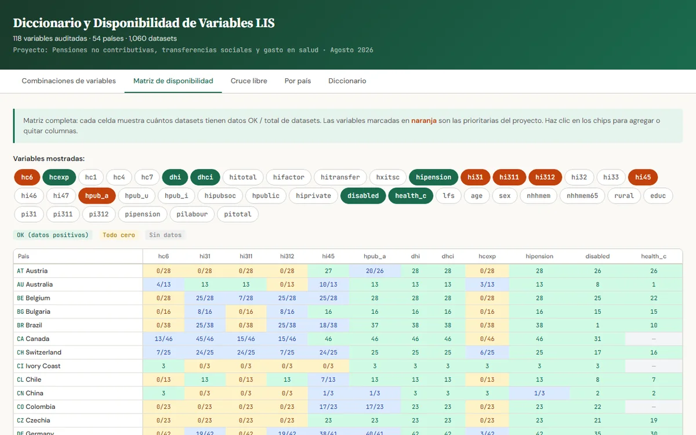

**Pregunta.** ¿En qué países y años se pueden estudiar a la vez las pensiones no contributivas, las transferencias sociales y el gasto de bolsillo en salud con el Luxembourg Income Study (LIS)?

**Resultado.** Audité 118 variables en 1,060 bases de datos de 54 países. El dashboard muestra, para cualquier combinación de variables, en qué países y años están disponibles al mismo tiempo.

**Qué hice.** Como asistente de investigación de la Dra. Isabel Guerrero (Departamento de Economía, PUCP), revisé la disponibilidad y la calidad de cada variable (por ejemplo `hi31` pensión no contributiva, `hc6` gasto en salud, `dhi` ingreso disponible) y construí un sitio con cinco vistas: combinaciones sugeridas, matriz de disponibilidad, cruce libre, ficha por país y diccionario.

**Pruébalo aquí:**

  <iframe src="https://lis.amandavalery.workers.dev/" style="width:100%;height:100%;border:0" loading="lazy" title="Dashboard LIS"></iframe>

[Abrir el dashboard en una pestaña nueva](https://lis.amandavalery.workers.dev/){: .btn .btn--primary}

*Los microdatos del LIS no se redistribuyen; el sitio solo muestra metadatos de disponibilidad.*
