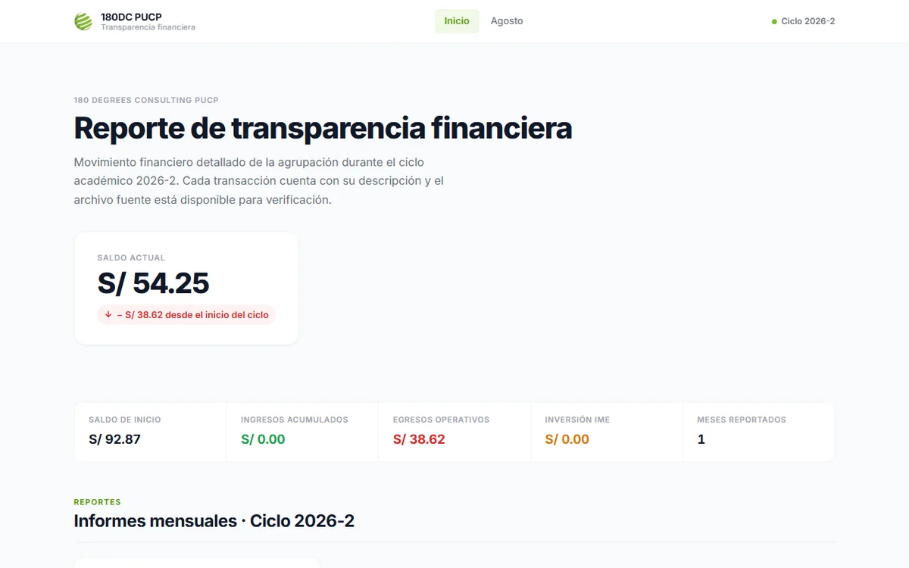

**Pregunta.** ¿Cómo puede cualquier miembro de una organización estudiantil verificar en qué se gasta el dinero del grupo, sin saber programar?

**Resultado.** Un portal que ya publica 6 informes mensuales de dos ciclos (marzo a agosto de 2026). El script comprueba que el saldo final de cada mes sea el saldo inicial del siguiente: el cierre de 2026-1 (S/ 92.87) es exactamente la apertura de 2026-2.

**Qué hice.** La tesorería llena un Excel por mes y escribe en `config_mes.py` para qué fue cada gasto. `build.py` lee los Excel, calcula ingresos, egresos operativos, inversión y saldo, y genera el sitio estático. GitHub Actions lo publica en cada push. Cada mes trae su Excel descargable para que cualquiera revise línea por línea. El README está escrito para personas que no programan.

[Ver el portal](https://av-gomez.github.io/sitio_180dc/){: .btn .btn--primary} [Código en GitHub](https://github.com/av-gomez/sitio_180dc){: .btn}
