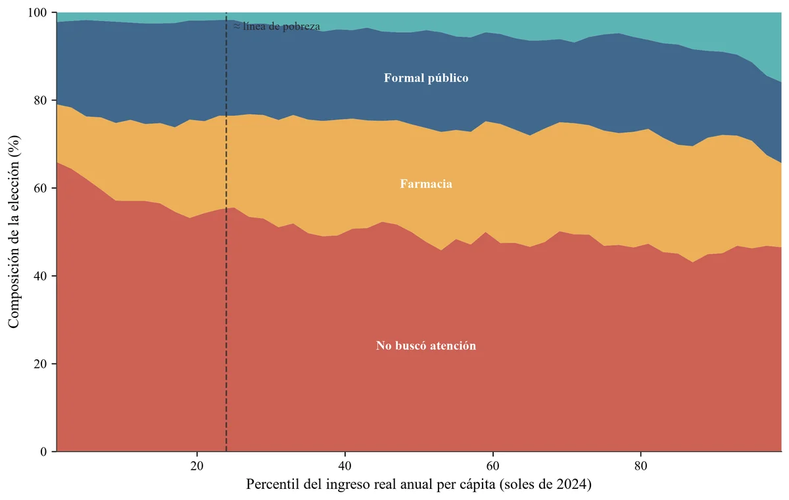

**Pregunta.** ¿Qué factores explican que una persona con una necesidad de salud elija un establecimiento público, uno privado, la farmacia o no atenderse?

**Resultado.** En el panel 2022-2024, 50.8 % de las personas de 18 a 65 años con una necesidad de salud no busca atención y 23.2 % la resuelve en una farmacia. La afiliación al SIS se asocia con 17.2 puntos porcentuales más de uso del sistema público y 13.8 puntos menos de no búsqueda. El modelo principal usa 17,339 observaciones persona-año.

*Composición de la elección por percentil de ingreso real per cápita. Elaboración propia con la ENAHO Panel 2022-2024.*

**Datos y método.** ENAHO Panel 2022-2024 (INEI). Logit multinomial con efectos aleatorios correlacionados (enfoque de Mundlak), que separa lo que cambia en la misma persona entre años de lo que difiere entre personas. Agrego indicadores provinciales del entorno sanitario: demora para conseguir cita, tiempo de traslado, tiempo de espera y experiencia de atención. Todo en Stata y Python.

**Contexto.** Tesis de licenciatura en Economía, PUCP. Asesor: Pedro Francke. Obtuve el primer puesto (1/87) en Seminario de Tesis 1.

[Leer el resumen de la tesis](/publication/2026-tesis-proveedor-salud){: .btn .btn--primary} [Fuente de los datos: INEI](https://www.inei.gob.pe/){: .btn}
