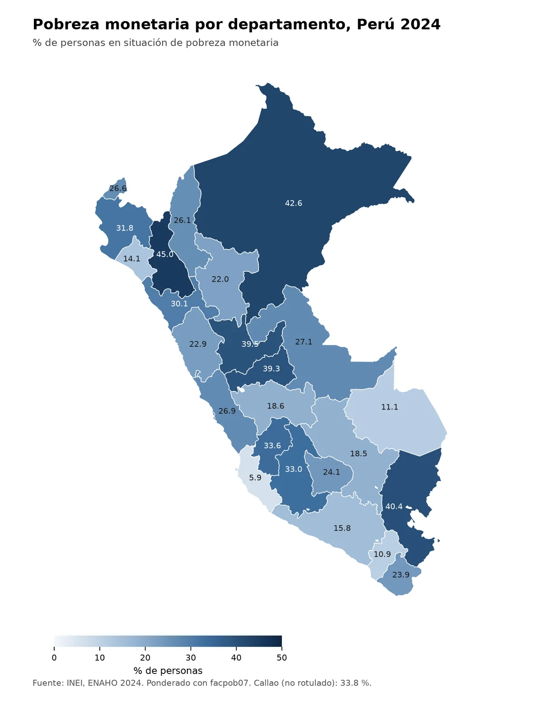

**Pregunta.** ¿Puede un agente limpiar los microdatos de la ENAHO, replicar la pobreza oficial y producir gráficos y mapas con reglas fijas?

**Resultado.** La skill de limpieza valida contra el INEI: 108,664 residentes habituales en la muestra (igual que el INEI) y pobreza total de 27.58 %, frente a 27.6 % oficial.

**Qué hice.** Escribí tres skills: `limpiando-enaho` une los módulos y valida las cifras, `graficando-enaho` hace barras de pobreza por área, sexo o edad, y `mapeando-enaho` hace un mapa por departamento unido por código de ubigeo. Las skills de gráfico y mapa piden correr primero la de limpieza si falta la base.

[Código en GitHub](https://github.com/av-gomez/skills-enaho){: .btn .btn--primary}
