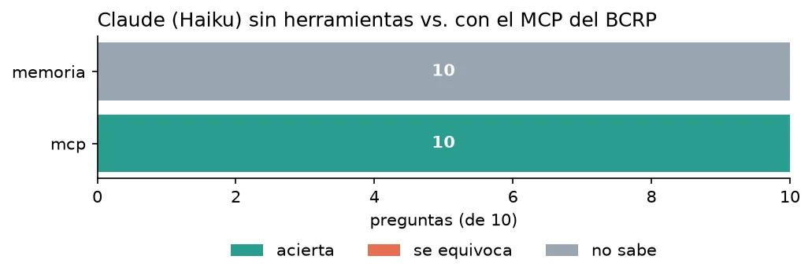

**Pregunta.** ¿Puede un asistente de IA dar cifras económicas recientes del Perú sin inventarlas?

**Resultado.** En una prueba con 10 preguntas sobre cifras recientes, Claude Haiku acertó 10 de 10 con el MCP y ninguna sin él. El servidor da acceso a 17,167 series estadísticas del Banco Central de Reserva del Perú.

**Qué hice.** Un servidor en Python con cuatro herramientas: buscar series, descargar datos, resumir y comparar. Cada número viene con el código de la serie, el periodo y la URL del BCRP. Las cuentas las hace Python, no el modelo.

**Otro servidor con el mismo enfoque.** [MCP del Banco Mundial](https://github.com/av-gomez/mcp-bancomundial): compara indicadores de desarrollo entre países, con la URL de la fuente en cada respuesta.

[Código en GitHub](https://github.com/av-gomez/mcp-bcrp){: .btn .btn--primary} [Informe de la prueba](https://github.com/av-gomez/mcp-bcrp/blob/master/informe.md){: .btn}
