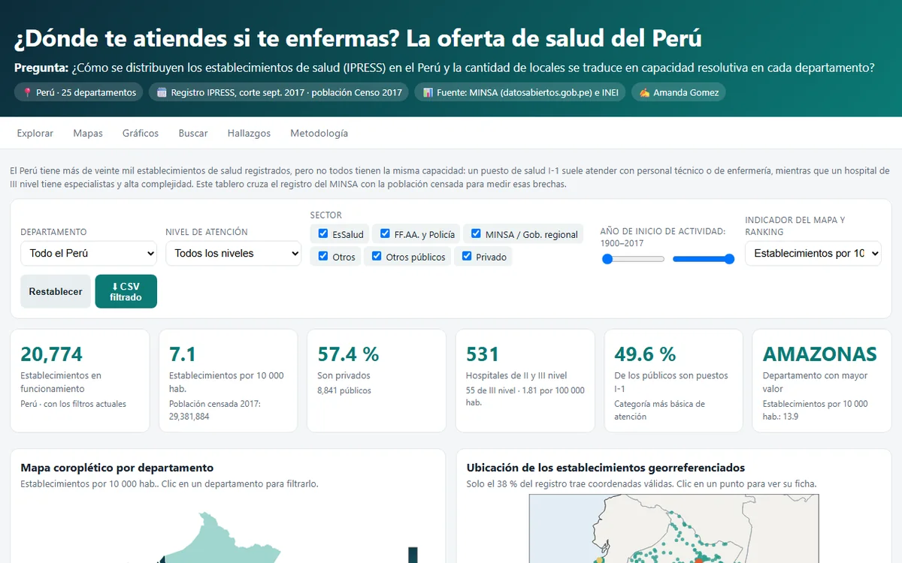

**Pregunta.** ¿Cómo se distribuyen los establecimientos de salud en el Perú y la cantidad de locales se traduce en capacidad resolutiva en cada departamento?

**Resultado.** Lima y Callao tienen 35.7 % de la población y 61.8 % de los hospitales de III nivel (34 de 55). 16 de 25 departamentos no registran ninguno. La correlación entre la densidad de establecimientos y los hospitales de II y III nivel por habitante es 0.15.

**Qué hice.** Limpié el registro IPRESS del MINSA (20,774 establecimientos después de la limpieza, corte a septiembre de 2017), lo crucé con el Censo 2017 y publiqué un dashboard con 6 indicadores y 6 visualizaciones que se recalculan con los filtros. También hice un reel de 54 segundos narrado con mi voz clonada con IA, con el aviso visible durante todo el video.

<!-- Cuando el reel esté en YouTube como no listado, pegar aquí:
<iframe width="100%" height="400" src="https://www.youtube.com/embed/ID_DEL_VIDEO" title="Reel: dónde te atiendes" frameborder="0" allowfullscreen></iframe>
-->

[Abrir el dashboard](https://av-gomez.github.io/salud-peru-ipress/web/){: .btn .btn--primary} [Código en GitHub](https://github.com/av-gomez/salud-peru-ipress){: .btn} [Post en LinkedIn](https://lnkd.in/p/du6VJm3q){: .btn}
