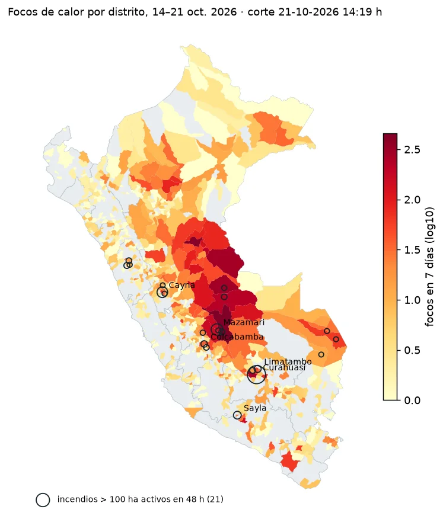

**Pregunta.** ¿Dónde arde, es una temporada excepcional y cuánto se quemó?

**Resultado.** En 7 días hubo 8,521 focos de calor en 645 distritos (corte: 21 de octubre de 2026). Del 1 al 20 de octubre se registraron 12,007 focos, 74 % más que la media 2012-2025. En Curahuasi se quemaron al menos 1,946 hectáreas, medidas con Sentinel-2.

**Qué hice.** Un informe con datos públicos (VIIRS, Sentinel-2, WorldPop), sin índices compuestos: cada variable se reporta medida, por separado. También un reel de 58 segundos, con guion revisado por mí contra el informe y voz clonada con aviso visible.

<!-- Cuando el reel esté en YouTube como no listado, pegar aquí:
<iframe width="100%" height="400" src="https://www.youtube.com/embed/ID_DEL_VIDEO" title="Reel: incendios forestales" frameborder="0" allowfullscreen></iframe>
-->

[Código e informe en GitHub](https://github.com/av-gomez/incendios-peru-2026){: .btn .btn--primary}
