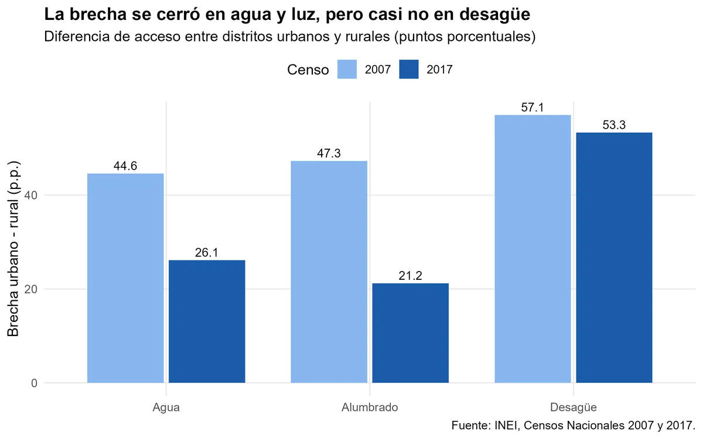

**Pregunta.** Entre 2007 y 2017, ¿se redujo la brecha de acceso a agua, desagüe y alumbrado entre los distritos más rurales y los más urbanos?

**Resultado.** La brecha bajó en agua (de 44.6 a 26.1 puntos porcentuales) y en alumbrado (de 47.3 a 21.2), pero casi no en desagüe (de 57.1 a 53.3). A nivel nacional, el acceso a agua subió de 63.7 % a 78.6 %.

**Qué hicimos.** Trabajo final grupal de Fundamentos de R (diplomatura Q-LAB PUCP), con Oscar Chávez, Fabricio Luna y Karen Macedo. Limpieza de los Censos Nacionales 2007 y 2017, indicadores para 1,830 distritos y reporte reproducible en Quarto.

[Ver el reporte](/files/reporte_servicios_basicos.html){: .btn .btn--primary}
