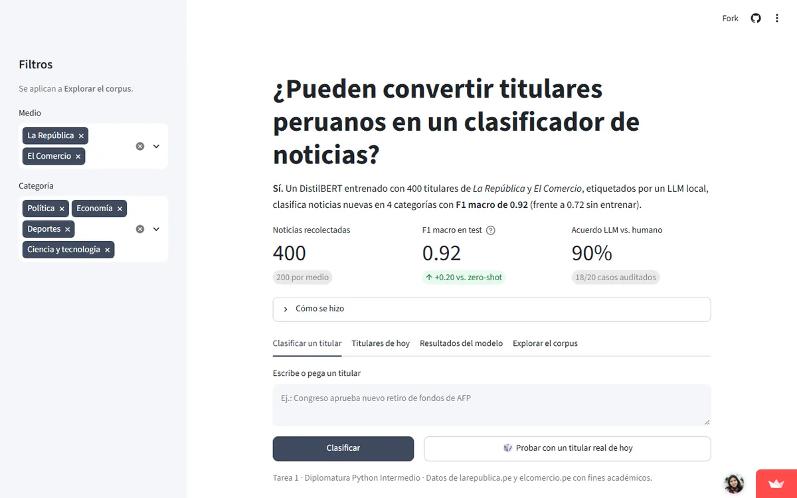

**Pregunta.** ¿Se pueden convertir titulares peruanos en un clasificador de noticias?

**Resultado.** Con 400 titulares de La República y El Comercio y etiquetas generadas por un LLM local, un DistilBERT ajustado en CPU alcanza F1 macro de 0.92 en un test reservado, frente a 0.72 de la línea base zero-shot.

**Qué hice.** Recolección con respeto a `robots.txt`, etiquetado semisupervisado, ajuste del modelo y un dashboard en Streamlit que clasifica titulares nuevos en 4 categorías.

*El dashboard está en Streamlit Community Cloud: si estuvo inactivo, tarda un momento en despertar.*

[Abrir el dashboard](https://clasificador-titulares-pe.streamlit.app/){: .btn .btn--primary} [Modelo en Hugging Face](https://huggingface.co/av-gomez/clasificador-titulares-pe){: .btn} [Código en GitHub](https://github.com/av-gomez/python-intermedio-qlab/tree/main/tarea_1){: .btn}
