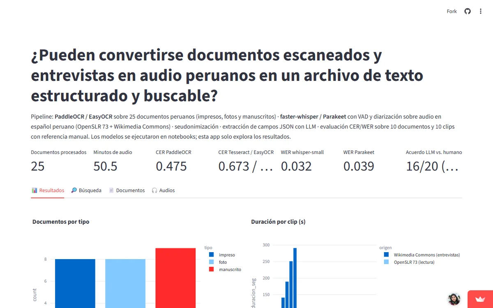

**Pregunta.** ¿Pueden convertirse documentos escaneados y entrevistas en audio peruanos en un archivo de texto estructurado y buscable?

**Resultado.** En audio, faster-whisper llega a un WER de 0.032. En documentos, PaddleOCR llega a un CER de 0.475 en promedio: 0.22 en fotos, 0.48 en impresos y 0.81 en manuscritos. Sirve para impresos y habla de estudio; los manuscritos coloniales y las entrevistas en la calle aún necesitan corrección humana.

**Qué hice.** Un corpus de 25 documentos y 26 clips de audio (50.5 minutos) con licencias revisadas, comparación de tres motores de OCR y dos de transcripción, seudonimización y un dashboard de búsqueda.

*El dashboard está en Streamlit Community Cloud: si estuvo inactivo, tarda un momento en despertar.*

[Abrir el dashboard](https://av-gomez-tarea2.streamlit.app){: .btn .btn--primary} [Código en GitHub](https://github.com/av-gomez/tarea_2){: .btn}
