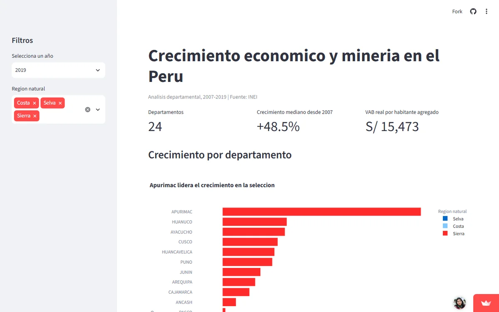

**Pregunta.** ¿Qué departamentos aumentaron más su producción por habitante entre 2007 y 2019, y ese crecimiento coincide con el peso de la minería?

**Resultado.** Apurímac subió 298 %, y casi todo el salto ocurre en 2016, cuando la minería pasa de 10 % a 61 % de su economía. Solo Madre de Dios (-23 %) y Moquegua (-3 %) retrocedieron. Son asociaciones, no causas.

**Qué hicimos.** Trabajo grupal de Fundamentos de Python (Grupo 9): 24 departamentos en 13 años, con un dashboard en Streamlit que tiene filtros, dispersión, mapa y tabla.

*El dashboard está en Streamlit Community Cloud: si estuvo inactivo, tarda un momento en despertar.*

[Abrir el dashboard](https://grupo9-crecimiento-regional.streamlit.app/){: .btn .btn--primary} [Código en GitHub](https://github.com/av-gomez/assignment_2_grupo_9/tree/main/assignment_3){: .btn}
