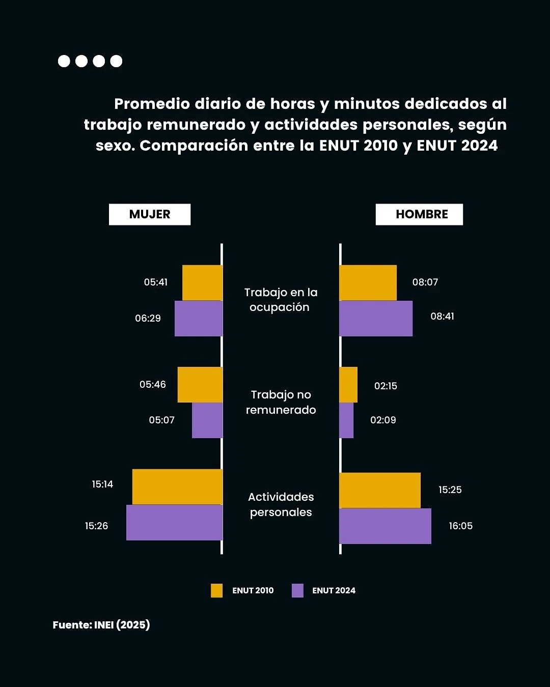

**Pregunta.** ¿Cómo ha evolucionado la pobreza de tiempo de las mujeres peruanas entre 2010 y 2024, qué efectos tiene y qué hacen las políticas públicas para reducirla?

**Resultado.** Según la Encuesta Nacional de Uso del Tiempo 2024 (INEI), las mujeres dedican 4 horas y 48 minutos diarios al trabajo no remunerado y los hombres, 1 hora y 35 minutos.

**Publicación.** Ybañez, M. y Gomez, A. (2025). *El tiempo que nos falta: Pobreza de tiempo, género y el rol pendiente de las políticas públicas en el Perú*. Blog del Laboratorio de Estudios Sociales (LES), PUCP.

[Leer el estudio de caso](https://lespucp.wixsite.com/laboratorio-de-estud/post/el-tiempo-que-nos-falta-pobreza-de-tiempo-g%C3%A9nero-y-el-rol-pendiente-de-las-pol%C3%ADticas-p%C3%BAblicas-en-e){: .btn .btn--primary} [Post en Instagram](https://www.instagram.com/p/DKNPkrjuEAY/){: .btn} [Reel](https://www.instagram.com/p/DKN07YyMM3v/){: .btn}
