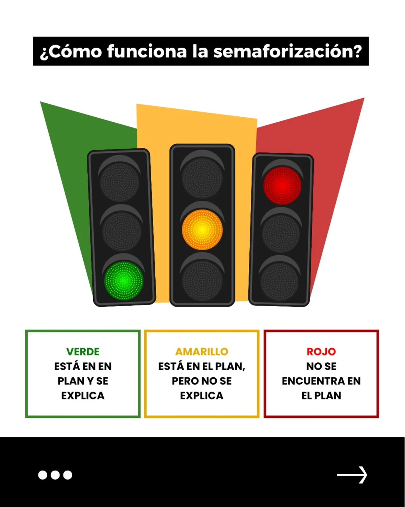

**Pregunta.** ¿Lo que un candidato dice en el debate presidencial está respaldado en su plan de gobierno?

**Resultado.** Una comparación con semáforo de 3 colores (está y se explica, está pero no se explica, no se encuentra) para 2 candidatos en 2 temas: salud y educación. Publicada por el Laboratorio de Estudios Sociales en las Elecciones 2026.

**Qué hice.** Apoyé directamente la comparación de los planes de gobierno. También apoyé la guía *Propuestas en verde* para las elecciones y el conversatorio *Nakama y nación*.

**Edición.** Como coordinadora de investigación académica reviso que los textos estén bien escritos, tengan buen contenido académico y puedan pasar por la revisión de otros expertos. Algunas columnas que revisé:

- [Crecimiento del PBI y bienestar social](https://www.instagram.com/p/DYkuoJrFgam/)
- [Vouchers educativos y educación pública](https://www.instagram.com/p/DOY-XBbDgQp/)
- [Polarización y derechos humanos](https://www.instagram.com/p/DdmeCgHltEh/)

[Sitio web del LES](https://lespucp.wixsite.com/laboratorio-de-estud){: .btn .btn--primary}
