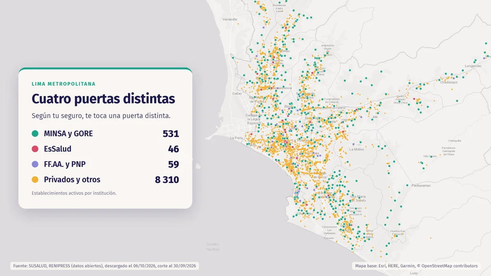

**Pregunta.** ¿Cómo ayudar a un paciente a saber a qué establecimiento ir en un sistema de salud fragmentado?

**Resultado.** El registro RENIPRESS (corte al 30 de septiembre de 2026) tiene 8,946 establecimientos activos en la provincia de Lima. 3,743 (41.8 %) no tienen ubicación válida y 92.9 % son privados u otros. Sobre esos datos abiertos planteamos un MVP centrado en una sola función: orientar y rutear.

**Contexto.** Lo desarrollamos un equipo de 5 en el Laboratorio de Emprendimientos 2026 de EQUIPU PUCP, un programa con más de 80 instituciones.

**Decisiones.** Dejamos fuera la reserva de citas (no hay APIs públicas) y la historia clínica personal (exige cumplir la Ley 29733 de datos personales). Modelo híbrido: gratis para el usuario, ingresos por convenios con el Estado.

<!-- Si hay video del pitch en YouTube, pegar aquí:
<iframe width="100%" height="400" src="https://www.youtube.com/embed/ID_DEL_VIDEO" title="Pitch Rikuy Salud" frameborder="0" allowfullscreen></iframe>
-->

[Abrir el mapa interactivo](/files/mapa_rikuy.html){: .btn .btn--primary}
