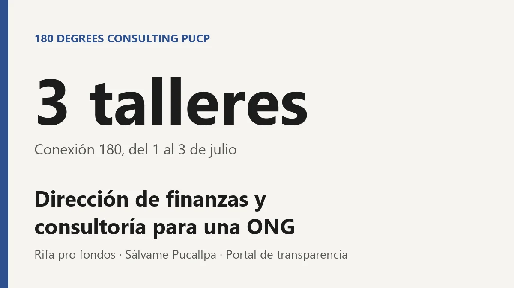

**Pregunta.** ¿Cómo consigue fondos una organización estudiantil y cómo rinde cuentas de ellos?

**Resultado.** Como directora de finanzas organicé *Conexión 180*, una serie de 3 talleres virtuales del 1 al 3 de julio sobre emprendimiento, finanzas con IA y finanzas personales, además de una rifa pro fondos. Sumé el [portal de transparencia financiera](/portfolio/02-portal-180dc/).

**Consultoría.** Fui consultora de estrategia para la ONG Sálvame Pucallpa: diagnóstico organizacional y estrategia de recaudación de fondos.

[Conexión 180 en Instagram](https://www.instagram.com/p/DaGVMIxEdIf/){: .btn .btn--primary} [Sálvame Pucallpa en Instagram](https://www.instagram.com/salvamepucallpa/){: .btn} [Sálvame Pucallpa en Facebook](https://www.facebook.com/salvamepucallpa/){: .btn}
